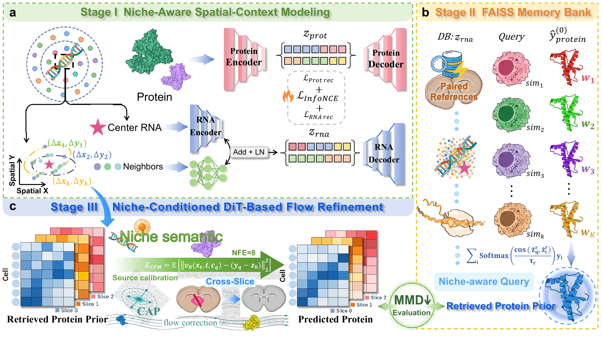

<a id="top"></a>

<div align="center">

<h1 align="center">🧬 NicheRFT</h1>

<h3 align="center">NicheRFT: Niche-aware Retrieval-augmented Flow Translation for Spatial RNA-to-Protein Prediction</h3>

<p>
  <a href="#framework"></a>
  <a href="#framework"></a>
  <a href="#core-workflow"></a>
  <a href="#quick-example"></a>
</p>

<p>
  <a href="#overview">✨ Overview</a> &nbsp;·&nbsp;
  <a href="#framework">🖼️ Figure 1</a> &nbsp;·&nbsp;
  <a href="#install">📦 Install</a> &nbsp;·&nbsp;
  <a href="#core-workflow">🧭 Workflow</a> &nbsp;·&nbsp;
  <a href="#quick-example">🚀 Example</a> &nbsp;·&nbsp;
  <a href="#split-aware-protocol">🛡️ Protocol</a> &nbsp;·&nbsp;
  <a href="#layout">🗂️ Layout</a>
</p>

</div>

---

<a id="overview"></a>

NicheRFT predicts spatially resolved protein abundance from RNA by combining a
niche-aware RNA representation, split-aware reference retrieval, a
fitting-set-calibrated stochastic protein source, and a DiT-style conditional
flow-matching vector field. The default inference path uses 8-step ODE
integration. The implementation is a flow-matching model, not a diffusion model.

<a id="framework"></a>

## 🖼️ Framework Overview

<p align="center">
  
</p>

<p align="center">
  <sub><b>Figure 1.</b> Niche-aware spatial-context modeling · FAISS memory bank · Niche-conditioned DiT-based flow refinement</sub>
  <br />
  <sub><a href="Figure/Figure1.pdf">📄 View the original figure (PDF)</a></sub>
</p>

---

<a id="install"></a>

## 📦 Install

```bash
  pip install -r requirements.txt
```

or
         
```bash
  conda env create -f environment.yml   
  conda activate nicherft     
```

<a id="core-workflow"></a>

## 🧭 Core workflow

The legacy script filenames retain `stage12`/`stage3` for compatibility, but the
model is conceptually organized as representation learning, reference retrieval,
source calibration, and conditional flow matching.

```bash
# Learn the niche-aware RNA representation and cache split-aware retrieval inputs
python -u experiments/cache_stage12.py \
    --dataset lymph \
    --data_path /path/to/Human_lymph_nodes.h5ad \
    --output_dir ./outputs/lymph_cache --k 128 --seed 42 --split_seed 42 \
    --device cuda

# Fit the DiT conditional vector field and evaluate the selected checkpoint
python -u experiments/finalize_stage3.py \
    --cache_dir ./outputs/lymph_cache \
    --output_dir ./outputs/lymph_flow \
    --seed 42 --k 128
```

The default flow inference evaluates the vector field at `NFE=8`; `NFE=16` is
also available for sensitivity analysis. Hyperparameters should be selected on
the validation subset only. `experiments/eval_sweep_fold0.py` evaluates cached
retrieval sweeps on validation data and never reads test labels for selection.

<a id="quick-example"></a>

## 🚀 Quick example

A self-contained, end-to-end run on a small **synthetic** dataset (no real data
required; CPU is sufficient). One command does everything:

```bash
bash examples/run_example.sh
# or:  PYTHON=python3 bash examples/run_example.sh
```

The script runs the full pipeline. The underlying steps, if you prefer to run
them individually, are:

```bash
# 1) Generate a two-slice synthetic dataset (examples/data/example.h5ad)
python examples/make_example_data.py --output_file examples/data/example.h5ad

# 2) Stage I/II: niche-aware RNA representation + split-aware retrieval cache
python -u experiments/cache_stage12.py --dataset example \
    --data_path examples/data/example.h5ad --output_dir outputs/example_cache \
    --k 128 --batch_size 32 --stage1_epochs 20 \
    --seed 42 --split_seed 42 --device cuda

# 3) Stage III: fit the DiT conditional flow field and evaluate (8-step ODE)
python -u experiments/finalize_stage3.py \
    --cache_dir outputs/example_cache --output_dir outputs/example_flow \
    --seed 42 --k 128 --prediction_nfe 8 --epochs 20
```

Artifacts land in `outputs/example_flow/fold0/seed42/` — `flow_pred_test.npy`,
`retrieval_pred_test.npy`, `flow_model.pt`, `run_config.json`, `metrics.json`.
The 8-step flow (`NFE=8`) improves on the retrieval prior on every reported axis:

| method | PCC-P | MMD | CMD-P | RMSE |
|---|---|---|---|---|
| Retrieval prior | 0.7107 | 0.0447 | 0.0979 | 1.9008 |
| Flow, NFE=8 | 0.7241 | 0.0087 | 0.0566 | 1.6599 |

See [examples/README.md](examples/README.md) for the full walkthrough,
including the optional source-calibration flag and the small-batch note for
small inputs.

<a id="split-aware-protocol"></a>

## 🛡️ Split-aware protocol

In brief:

- the retrieval bank contains fitting/training cells only;
- self-exclusion is used only for fitting cells that are themselves bank members;
- validation and test/query cells retrieve only from the fitting bank;
- gene selection and source calibration use fitting cells only;
- validation proteins are used only for model selection;
- test/query proteins are used for scoring and consistency hashes, never for fitting or model selection.

<a id="layout"></a>

## 🗂️ Layout

- `core_modules/` — attention, losses, spatial graph, and retrieval bank
- `models/` — niche-aware encoder, DiT blocks, and conditional flow model
- `experiments/` — training, validation selection, evaluation, and ablations
- `examples/` — synthetic quick-start dataset generator and end-to-end script
- `pipeline/` — dataset configuration
- `utils.py`, `metrics.py` — preprocessing and evaluation utilities

<a id="paths"></a>

## 🧷 Paths

Core training scripts take paths through CLI arguments. Helper scripts resolve
output paths through `paths.py` and environment variables; evaluation no longer depends on an external benchmark bundle.
No trained checkpoints, prediction arrays, metric files, or prior experimental
results are included in this source archive.

<a id="full-pipeline-paper-run"></a>

## 🔬 Full-pipeline paper run (recommended)

```bash
python experiments/run_paper_protocol.py --dataset lymph \
  --data_path /data/Human_lymph_nodes.h5ad --output_dir outputs/paper_lymph \
  --controls --solver_sweep
```

Stage I/II caches are rebuilt separately for seeds 42--46 while the fitting,
validation and test memberships stay fixed. This differs from a shared-cache
Stage-III-only seed sweep. Dataset retrieval presets are tonsil=32, lymph=128,
breast=2048. Use a new empty output directory. `--dry_run` prints commands.

---

<p align="right"><a href="#top">⬆ Back to top</a></p>
